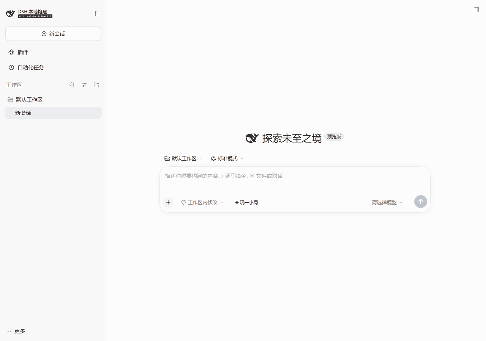

# 玩一小局 · Whileplay

在 DeepSeek Harness 等待 AI 回复时，随手玩一小局。

内置飞机大战、坦克大战和贪吃蛇。游戏运行在可移动、可缩放的悬浮窗口中，也可以切换成只显示游戏画面的极简模式。

## 效果展示

从聊天输入框旁打开「玩一小局」，体验飞机大战、坦克大战、贪吃蛇与极简模式。



## 安装与启动

### 环境要求

- 已安装 [DeepSeek Harness](https://github.com/deepseek-ai/deepseek-harness)，使用 Web profile。
- Node.js `^22.19.0 || >=24.0.0` 与 npm。
- 目前已在 DeepSeek Harness `0.2.1-alpha.4` 上验证，其他版本尚未验证。

### 1. 下载安装包

下载 **[dsh-whileplay-0.1.0.tgz](https://github.com/monster-cli/dsh-whileplay/releases/download/v0.1.0/dsh-whileplay-0.1.0.tgz)**。

版本说明见 [v0.1.0 Release](https://github.com/monster-cli/dsh-whileplay/releases/tag/v0.1.0)。安装插件使用 `.tgz` 附件；GitHub 自动提供的 Source code 压缩包用于源码开发。

### 2. 安装到 Web profile

在安装包所在目录打开终端，执行：

```sh
dsh plugin --profile web add ./dsh-whileplay-0.1.0.tgz
```

这条命令将 Whileplay 添加到 Web profile 的插件依赖中。

通过 npm 运行 Harness、没有全局 `dsh` 命令的用户，使用：

```sh
npx @deepseek-ai/dsh plugin --profile web add ./dsh-whileplay-0.1.0.tgz
```

### 3. 打开游戏

启动或重启 Harness Web profile：

```sh
dsh web
```

通过 npm 运行 Harness 时使用 `npx @deepseek-ai/dsh web`。

打开终端输出的页面，点击聊天输入框旁的 **「◈ 玩一小局」**，选择游戏，再点击「开始游戏」。

## 三款小游戏

| 游戏 | 操作 | 玩法 |
| --- | --- | --- |
| 飞机大战 | 左右方向键，或在画布上拖动 | 自动发射子弹，击落敌机每架 +10 分；撞到敌机结束本局 |
| 坦克大战 | 方向键移动转向，空格射击 | 击毁敌坦克每辆 +100 分，守卫底部基地 |
| 贪吃蛇 | 方向键转向 | 吃食物增长，避开边界和自己 |

坦克大战包含砖墙、钢墙和敌方坦克。砖墙可以逐块击碎，钢墙不可破坏，双方子弹可以互相抵消。玩家有 3 条生命，受击重生后短暂无敌；生命耗尽或基地被任意一方的子弹击毁时结束。

游戏库支持搜索与分类，窗口和画布跟随 DSH 的浅色、深色主题。画布获得焦点后响应键盘操作，Escape 收起游戏窗口。

## 移动、缩放与极简模式

- **移动窗口**：拖动标题栏或点状手柄。
- **调整大小**：拖动窗口四边或四角。游戏画面保持比例，游戏速度保持不变；窗口缩窄后，游戏库折叠到顶部按钮中。
- **进入极简模式**：点击标题栏「极简模式」，收起游戏库、标题、分数、说明和工具栏，只保留游戏画面。
- **极简模式操作**：鼠标移入画面，浮现移动、暂停/继续、恢复完整模式和收起按钮。点击 `↗` 恢复完整窗口。触屏上始终显示这些必要控件。
- **继续游玩**：移动或缩放时游戏会暂停，调整完成后点击「继续」。切换完整/极简模式会保留本局进度，恢复完整模式时还原之前的窗口尺寸。

移动和缩放手柄也支持聚焦后用方向键操作。窗口会保持在浏览器视口内，浏览器缩小时自动调整位置与尺寸。

## 会话联动与进度保存

当前会话结束运行、需要审批或补充信息、会话状态不可用时，游戏会自动暂停。切出窗口、隐藏页面或焦点离开游戏小窗时也会暂停；回到游戏后手动继续。

会话停止运行的提示表示需要查看回复，不表示任务一定成功。极简模式下同样会显示需要返回会话处理的提示。

收起窗口保留当前页面内的游戏进度。切换游戏会重新开局；刷新页面会重置本局进度、窗口位置与尺寸，最高分仍保留在浏览器本地。浏览器禁止本地存储时，界面会提示最高分仅在本次打开期间保留。

插件自身不调用模型、不注册 AI 工具，也不向会话注入游戏内容。仅玩游戏不需要模型 API Key。

## 卸载

执行以下命令，然后重启 Web profile：

```sh
dsh plugin --profile web remove dsh-whileplay
```

通过 npm 运行 Harness 的用户使用 `npx @deepseek-ai/dsh plugin --profile web remove dsh-whileplay`。卸载不会自动清除浏览器中保存的最高分。

## 从源码安装

修改插件或自行构建时，克隆仓库并打包：

```sh
git clone https://github.com/monster-cli/dsh-whileplay.git
cd dsh-whileplay
npm pack
```

`npm pack` 会先自动构建，再生成 `dsh-whileplay-0.1.0.tgz`。安装生成的包：

```sh
dsh plugin --profile web add ./dsh-whileplay-0.1.0.tgz
```

构建使用 Node.js 内置工具，无需额外安装 npm 构建依赖；浏览器中的 React 由 Harness 提供。开发预览、测试和发布流程见 [开发指南](https://github.com/monster-cli/dsh-whileplay/blob/main/docs/DEVELOPMENT.md)。

## 反馈与许可证

问题反馈：[GitHub Issues](https://github.com/monster-cli/dsh-whileplay/issues)。

[MIT License](LICENSE)，Copyright © 2026 Whileplay contributors。
