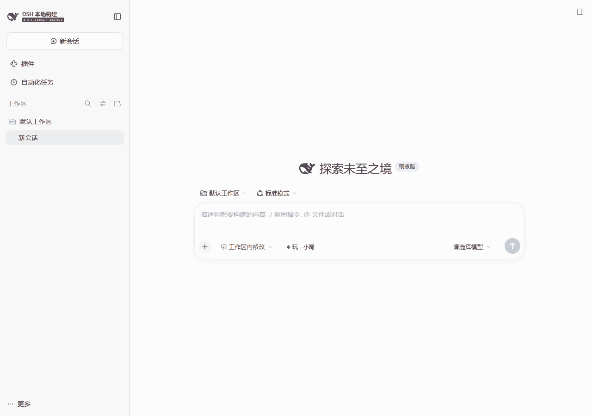

# 玩一小局 · Whileplay

简体中文 | [English](README.en.md)

[](https://github.com/monster-cli/dsh-whileplay/releases/latest)
[](LICENSE)

**AI 推进任务，你守住航程。**

Whileplay 是 [DeepSeek Harness](https://github.com/deepseek-ai/deepseek-harness) 的任务联动游戏插件。当前会话的 Todo 化作海上航程，工具调用带来拦截机和补给，完成子任务的 Agent 加入护航编队，交付文件装上运输船。你驾驶战机，在 AI 工作的同时移动、射击、闪避，护送成果前行。

六款游戏，两种等待的节奏：飞机大战、坦克大战和贪吃蛇把工具调用变成目标与补给；国际象棋和五子棋让你静下来下一局，支持本地电脑对手与同屏双人。

一边让 AI 继续工作，一边打一小局。需要你查看回复或处理审批时，游戏会自动暂停。

[立即安装](#快速开始) · [任务护航](#小队护送远征让当前任务进入战场) · [经典游戏](#三款游戏三种任务玩法) · [棋类对弈](#国际象棋与五子棋落一子等一个好答案) · [v0.4.0 更新](docs/releases/v0.4.0.md)

## 为什么试试玩一小局

- **每个任务，都有自己的航程。** 任务标题、Todo、Agent 编队和交付清单跟随当前会话更新；没有收到的数据明确显示为空。
- **亲手操作的实时战斗。** 四向移动、自动射击、冲刺、修复与空袭；任务事件改变战场，游戏胜负不会影响 AI 执行。
- **动静皆宜的六款游戏。** 想操作就移动、射击、护航；想思考就与电脑或朋友对弈，胜负都有明确结算。
- **游戏窗口随手摆放。** 支持拖动和缩放，进入游戏和返回游戏库保持相同位置与尺寸；经典游戏与棋类均提供极简模式。
- **随时回到正事。** 会话结束运行、等待审批或需要补充信息时自动暂停；回来后再继续这一局。
- **装好就能试玩。** 四款动作与街机游戏提供无需模型的「联动演练」，两款棋类提供本地对弈。经典游戏与棋类支持中英文和浅深色主题；远征目前使用中文界面。

## 效果展示

从聊天输入框旁打开「玩一小局」，体验飞机大战、坦克大战和贪吃蛇的任务联动与道具。



## 快速开始

需要已安装的 DeepSeek Harness Web profile，以及 Node.js `^22.19.0 || >=24.0.0` 和 npm。当前版本已在 Harness `0.2.1-alpha.4` 上验证，其他宿主版本尚未验证。

**1. 下载插件。** [下载 v0.4.0 安装包](https://github.com/monster-cli/dsh-whileplay/releases/download/v0.4.0/dsh-whileplay-0.4.0.tgz)，包含小队护送远征、飞机大战、坦克大战、贪吃蛇、国际象棋和五子棋，无需克隆源码或自行构建。

**2. 安装并启动。** 在安装包所在目录执行：

```sh
dsh plugin --profile web add ./dsh-whileplay-0.4.0.tgz
dsh web
```

已有 Harness Web 服务正在运行时，请安装后重启 Web profile。

<details>
<summary>没有全局 dsh 命令？使用 npx</summary>

```sh
npx @deepseek-ai/dsh plugin --profile web add ./dsh-whileplay-0.4.0.tgz
npx @deepseek-ai/dsh web
```

</details>

### 开始游玩

打开 `dsh web` 在终端输出的**完整 URL**，完成网页认证。点击聊天输入框旁的 **「◈ 玩一小局」**，选择游戏，再开始游玩。动作与街机游戏可以通过 **「联动演练」** 体验目标和道具；国际象棋与五子棋点击 **「开始对弈」** 即可开局。

真实任务联动需要先在 DSH **设置 → 模型** 中配置提供商凭据、选择模型并运行任务。插件读取的是当前 **DSH 会话**，不会读取其他应用中的任务，也不会额外调用模型。

## 小队护送远征：让当前任务进入战场

护送运输船穿过岛屿与礁石，用战机挡住敌人的进攻。移动、自动锁敌、闪避弹幕和收集补给组成持续的实时战斗；任务信息同时显示在战场和右侧简报中。

| 当前任务发生了什么 | 战场如何响应 |
| --- | --- |
| 生成或更新 Todo | 航点显示真实 Todo 标题和状态，航程随任务进展更新 |
| 调用工具 | 带工具名称的拦截机入场；工具返回不会让它突然消失 |
| 工具成功返回 / Step 结束 | 分别投放火力 / 护盾补给，移动拾取后生效 |
| 子 Agent 完成任务 | 确认本轮完成的 Agent 成为僚机，最多两架协同射击 |
| 呈交文件 | 运输船显示已交付文件名；普通文件写入不算交付 |
| 会话停止或需要处理交互 | 战场暂停，让你回到会话；不会据此宣称任务成功 |

默认 **「当前会话」** 模式展示真实数据，未提供 Todo、子 Agent 或交付物时显示空态。切换到 **「联动演练」**，可体验「番茄钟小站」的完整示例航程；两种模式明确区分、分别存档。

**操作：** `WASD` / 方向键或拖动战机移动，自动射击；`Space` 闪避冲刺，`Q` 消耗修复支援，`E` 消耗空袭支援，`Escape` 暂停。能量拾取提升火力，连击增加得分；战机或运输船生命耗尽时本局结束，不影响真实任务。

## 三款游戏，三种任务玩法

| 游戏 | 经典玩法 | 工具调用带来的目标 | 完成一步任务后的补给 |
| --- | --- | --- | --- |
| **飞机大战** | 上下左右移动，自动射击 | 扫描机弹幕、运输机货舱、装甲机弱点、重装机蓄力炮 | 双发、护盾、炸弹，以及二选一成长升级 |
| **坦克大战** | 穿越砖墙与钢墙，射击敌坦克、守卫基地 | 需要命中三次的精英坦克 | 连发、护盾、战场炸弹 |
| **贪吃蛇** | 吃食物增长，避开边界和自己 | 带工具名称的限时奖励果实 | 双倍得分、护盾、减速 |

工具生成的目标按游戏规则参与本局，直到被击败、收集或离场。游戏胜负与任务执行相互独立。飞机大战的工具目标同时最多两个，密集调用依次入场。

### 操作

- **飞机大战**：方向键移动，也可在画布上拖动；自动发射子弹。升级出现时，接住其中一枚胶囊，或点击升级按钮、按 `1` / `2` 选择。
- **坦克大战**：方向键移动和转向，`Space` 射击。砖墙可击碎，钢墙不可破坏，双方子弹可以互相抵消。玩家有 3 条生命，生命耗尽或基地被击毁时结束。
- **贪吃蛇**：方向键转向，收集食物与奖励果实。

点击画布后即可使用键盘。窗口内也提供方向与射击按钮；按 `Escape` 收起游戏窗口。

### 飞机大战：这次任务，换一种打法

搜索扫描机会预警扇形弹幕；读取运输机的货舱被打中后释放补给；工程装甲机需要攻击侧翼弱点，或等待护甲打开；命令重装机锁定位置后发射重炮。工具目标入场后独立参与战斗，工具返回不会让它突然消失。

Step 完成除了掉落补给，还会逐步解锁二选一升级。**火力**从双发成长为散射和穿透；**生存**提供护盾、护盾再生与一次紧急救援；**机动**提高速度，最终可以通过擦弹得分与充能。错过升级胶囊也能通过按钮稍后领取。每条路线最多三级，后续升级所需 Step 逐渐增加。

密集工具调用按双机编队依次入场，编队之间留有间隔，超过等待容量的调用会折算成有限的额外补给；工具稀疏时仍有普通敌机。飞机大战的「联动演练」包含四类敌机、密集编队、补给和成长选择，随时可以暂停。

### 接住道具，改变这一局

AI 每完成一步（Step），就会送来一份补给，拾取额外 +20 分。飞机道具向下飘落，坦克道具出现在可达的空闲通道，贪吃蛇道具出现在空白格。坦克与贪吃蛇的道具、奖励果实保留 12 秒。

| 道具 | 效果 |
| --- | --- |
| **双发 / 连发 / 双倍得分** | 分别增强飞机火力、坦克射速或贪吃蛇得分，持续 8 秒；重复拾取刷新时长。 |
| **护盾** | 抵挡一次伤害，不叠加。贪吃蛇会尝试转向相邻安全格；没有安全方向时仍结束本局。 |
| **清屏炸弹** | 飞机清除敌弹、击毁普通敌机，对 Boss 造成 6 点伤害；坦克清除敌弹和敌坦克，保留墙体与基地。 |
| **减速** | 贪吃蛇移动速度降低，持续 8 秒，给转向留出更多时间。 |

击落工具飞机 +100 分，击毁精英坦克 +200 分，吃到工具果实 +30 分并增长一格。贪吃蛇双倍得分期间，普通食物、工具果实与补给的拾取得分均翻倍。暂停期间，道具倒计时与加成时间一并冻结。

## 国际象棋与五子棋：落一子，等一个好答案

在游戏库的 **「棋类」** 分类中选择国际象棋或五子棋。默认与轻量本地电脑对弈，也可切换 **「本地双人」**，在同一棋盘轮流落子。电脑计算在浏览器内完成，无需模型、API Key 或在线对手。

| 游戏 | 规则与操作 | 人机对弈 |
| --- | --- | --- |
| **国际象棋** | 点击棋子查看合法落点，再点击目标格；支持将军、将杀、王车易位、吃过路兵和四种升变 | 你执白先行，电脑执黑；适合休闲练习 |
| **五子棋** | 15×15 棋盘，横、竖或斜向五连获胜；长连也算胜利，无禁手 | 你执黑先行，电脑执白；电脑会争胜并防守直接威胁 |

每局提供棋谱、最后一手标记和悔棋；五子棋会高亮获胜连线。人机模式悔棋退回到你落子前，双人模式退回一手。棋盘支持鼠标、触屏，以及方向键移动焦点后按 Enter 落子。

**胜负有落点，下一局有入口。** 人机对弈结束时弹出「你赢了」或「本局落败」，双人模式显示获胜方，和棋单独展示。点击「查看棋盘」回看终局，点击「再来一局」立即开始。未结束的棋局重开前会弹出居中确认框，避免误清空。

两款棋类按会话在当前浏览器自动存档，切换游戏或刷新后手动继续。极简模式收起说明与棋谱，保留棋盘和操作按钮。任务结束、需要审批或页面失焦时自动暂停；工具调用不会改变棋盘规则或替你落子。

## 小窗游玩，随时回到会话

- **移动与缩放**：拖动标题栏或点状手柄移动窗口，拖动四边或四角调整大小。进入游戏、切换棋类和返回游戏库共用同一窗口位置与尺寸，调整后不会跳回原处。调整窗口时游戏暂停，点击「继续」即可恢复。
- **极简模式（经典游戏）**：收起游戏库、标题和工具栏，只保留游戏画面。鼠标移入画面即可找到移动、暂停和恢复完整模式的按钮；触屏上始终显示这些控件。
- **自动暂停**：会话结束运行、需要审批或补充信息、状态不可用时暂停。切出浏览器窗口或隐藏页面也会暂停，回到游戏后手动继续。

飞机大战会在当前浏览器中按会话保存最近八份存档，包含战场、道具、升级和演练进度；切换游戏、切换会话或刷新后可以手动继续，恢复时有短暂准备时间。「重新开始」或重新启动演练会覆盖该会话的飞机存档。浏览器禁止存储时会显示提示。

坦克和贪吃蛇在当前页面收起窗口后保留进度，切换游戏或会话、刷新后重新开局。窗口布局刷新后重置；最高分保存在当前浏览器中。任务结束时会暂停并显示本次结算，可以先返回会话，稍后继续飞机大战。

远征按会话分别保存真实护航和演练进度，刷新后手动继续。真实任务的请求摘要、Todo 文本、Agent 名称和交付文件名不写入游戏存档；工具参数、输出和文件内容不进入游戏。

## 常见问题

**需要配置模型或 API Key 吗？**

小游戏和「联动演练」都无需模型或 API Key，也不会额外发起模型请求。使用真实任务联动时，按 DeepSeek Harness 的要求配置并启动 AI 任务即可。

**演练按钮为什么不可用？**

三款经典游戏在当前会话执行任务或等待你的操作时禁用演练，真实任务开始后自动接入会话进度。远征通过「当前会话 / 联动演练」手动切换；真实会话需要处理交互时，两种模式都会暂停。

**页面提示 authentication required，或任务提示 no API key？**

前者是网页访问认证：重新打开 `dsh web` 启动时输出的完整 URL。后者是模型凭据缺失：在 **设置 → 模型** 中填写并保存相应提供商的 API Key，再选择模型重新发送任务。独立 `DSH_HOME` 数据目录需要单独配置凭据。

**如何升级或卸载？**

升级时下载新版 `.tgz`，再次执行安装命令并重启 Web profile。卸载执行以下命令，然后重启 Web profile：

```sh
dsh plugin --profile web remove dsh-whileplay
```

通过 npm 运行 Harness 时使用 `npx @deepseek-ai/dsh plugin --profile web remove dsh-whileplay`。卸载不会自动清除浏览器中保存的最高分。

## 参与项目

欢迎通过 [Issues](https://github.com/monster-cli/dsh-whileplay/issues) 反馈问题、提出新玩法或游戏建议。源码安装、开发与测试说明见 [开发指南](https://github.com/monster-cli/dsh-whileplay/blob/main/docs/DEVELOPMENT.md)。

[MIT License](LICENSE) · 国际象棋规则引擎 chess.js 使用 BSD-2-Clause，详见 [第三方许可](THIRD_PARTY_NOTICES.md)。
